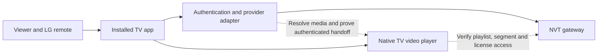

# Project plan

## Outcome and scope

Build an installable LG webOS app for an LG OLED C5 that signs an eligible viewer into NVT, lists available live channels, and plays a selected channel fullscreen with remote controls. Make the code suitable for later open-source publication and independent use with other viewers' own accounts.

The MVP starts with M4 Sport. Add M1, M2, M5, Duna, Duna World, and available event feeds incrementally as their access and playback are verified. Include account status, sign-out, session expiry, network recovery, and helpful playback errors. Use Hungarian UI first, with strings separated for later English translation.

On-demand catalogues, recordings, downloads, multi-account switching, casting, older-TV support, and app-store release are outside the MVP. Watching should ultimately happen inside our installed app with a TV-focused UI; merely launching the provider page is a feasibility probe, not the finished experience.

## Architecture to evaluate

Preferred product shape: a packaged webOS application with a small TV UI, a provider adapter, and the native HTML video player. Use a bundled JS service only where its networking/session capabilities are needed. This is a hypothesis, not an established authentication solution.



| Candidate | Choose it when | Main question to prove |
| --- | --- | --- |
| Packaged UI plus direct authorized playback; service for login/resolution if needed | We can reproduce the normal login and feed a playable authorized resource to the TV engine | Does playback authenticate all requests without depending on unavailable browser cookies? |
| Hosted HTTPS app with browser-mediated login | A supported navigation/return flow retains the required session and permits our player | Can we return to our UI and play across the actual origins? Hosting alone does not solve cookie scope or CORS. |
| App-scoped on-TV media relay | Direct native playback cannot carry required authentication and a local relay is viable | Can a jailed JS service safely serve the native player for sustained playback? Prove binding, permissions, lifecycle, and manifest rewriting. |
| Optional self-hosted home companion | TV-only approaches demonstrably fail | Does the benefit justify requiring an always-on household device? Record a revised architecture before proceeding. |

Evaluate the least complex viable route first. Do not assume arbitrary native-player headers, shared cookie jars, iframe access, continuous JS service lifetime, or a provider device-code API. A relay, if necessary, must be narrowly scoped and must not become an open proxy. No central project backend is planned.

## Milestone 0 — Repository and plan

- [x] Initialize local Git on `main`.
- [x] Document intended product, C5 target, research, and session requirements.
- [x] Ignore local secrets, captures, and build output.
- [ ] Choose an open-source license and remote repository before publication.

## Milestone 1 — Prove login and playback

1. Read the TV's installed webOS version and firmware. Enable LG Developer Mode and connect the development machine when the TV is available.
2. Inspect signed-out login in an isolated session, preserving the owner's existing browser login. Capture only redacted protocol structure, including challenges and logout.
3. Inspect one successful live playback request chain: resolver, manifest, segments, tokens, and any encryption/license traffic. Determine required credentials and origins.
4. Build the smallest disposable TV probe to authenticate and play M4 through the normal authorized access path. Try native HLS first if the stream is HLS; add another supported playback path only when evidence requires it.
5. Test signed-out failure, wrong credentials, expiry, logout, and relaunch. Record limits separately from desktop observations.
6. Write a short architecture decision with the selected route, alternatives rejected, minimum platform version, and session persistence policy.

**Exit criterion:** independent login on the C5, at least 30 minutes of stable live playback with audio, and clean sign-out. Repeat using another eligible account sequentially when one is available; account-independent code and synthetic tests do not replace that final verification. No full UI build before the first real login-to-playback success.

## Milestone 2 — Installable app foundation

After the feasibility decision, use TypeScript with a small UI/build stack compatible with the verified target. Select the UI framework then; a plain DOM UI is sufficient for the first small channel list. Keep provider code independent of UI components. If a JS service is required, compile it separately for the TV's documented Node runtime and bundle only compatible pure-JavaScript dependencies.

Proposed source layout, to create during implementation:

```text
apps/tv/                 TV screens, focus behavior, player, webOS metadata
packages/provider-nvt/   Authentication, channel discovery, media resolution
services/nvt/            Optional app-owned networking/session service
tests/fixtures/          Synthetic HTML, redirects, manifests, and errors
docs/                    Findings, decisions, setup, and release instructions
```

Add webOS app metadata and original icons. Declare `requiredACG` according to the APIs actually used, including an empty array when appropriate. Establish reproducible build, type checking, targeted tests, and IPK packaging. Document LG Developer Mode installation and session renewal. Do not hardcode a developer's TV address or passphrase.

**Exit criterion:** a clean checkout can build and install the app, and every screen is usable with directional keys, OK, Back, and the Magic Remote pointer.

## Milestone 3 — Live viewing MVP

- Sign-in and account status screens using the proven flow.
- Channel list with stable channel identifiers; resolve short-lived media only on selection.
- Fullscreen video with visible focus, loading state, play/pause where supported, Back, and a return-to-live action only if supported by the stream.
- Clear distinctions between expired login, unavailable event, provider capacity, network interruption, and unsupported media.
- Bounded recovery attempts; pause/stop on suspension and revalidate on resume.
- Sign-out with local session deletion. Remember-me only if protected persistence passed the feasibility review.

**Exit criterion:** an ordinary remote-only session can open the app, sign in, switch between verified channels, recover from a connection interruption, and sign out without a laptop.

## Milestone 4 — Reliability and open-source release

Add meaningful tests for provider parsing, redirect validation, session expiry, manifest resolution, account cleanup, and secret redaction using synthetic fixtures. Test focus navigation and lifecycle on the C5. Exercise stream switching, standby/resume, cold launch, expired sessions, and provider failures; check that only one stream runs at a time.

Choose a license, document support boundaries and privacy behavior, provide installation and contributor instructions, add issue templates discouraging raw captures, and review dependencies and repository history for secrets. Publish source and a reproducible IPK once ready. App-store submission is a separate distribution project with its own provider and LG requirements.

**Exit criterion:** a second eligible viewer can follow the instructions without source changes or access to the maintainer's account, and no private account data is present in the release or history.

## Immediate next work

Start Milestone 1 with an isolated signed-out browser inspection and the C5 Developer Mode setup. The missing information is the actual login/media protocol and real-TV behavior; choosing an elaborate UI framework will not resolve either.

## Sources and evidence

See [research notes](RESEARCH.md) for observations and primary sources. Additional platform guidance: [packaged and hosted apps](https://webostv.developer.lge.com/develop/getting-started/web-app-types), [developer workflow](https://webostv.developer.lge.com/develop/getting-started/developer-workflow), and [current ACG notice](https://webostv.developer.lge.com/).
